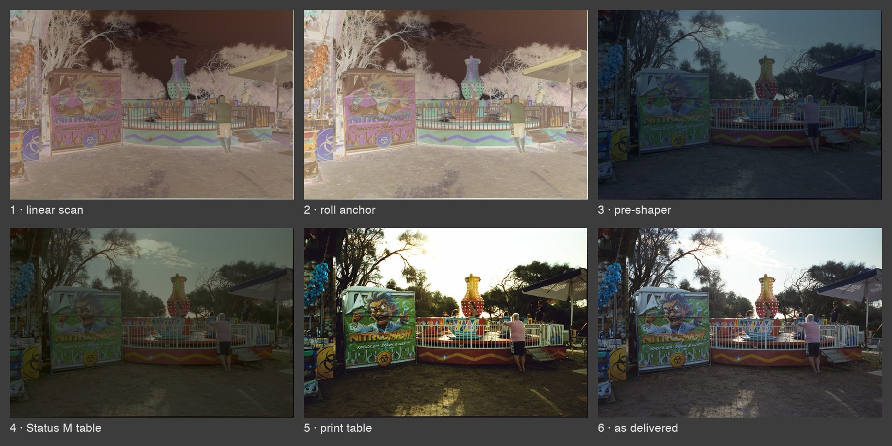

# Using the tables in DaVinci Resolve

This document covers everything between a developed roll and a graded image:
capturing the scan, measuring the roll, and the node chain for each of the
three film processes. The reasoning behind the transforms is in
[method.md](method.md), and every parameter is documented in
[PROJECT.md](../PROJECT.md).

[Installing the tables](#installing-the-tables) · [Scanning a roll](#scanning-a-roll) · [Resolve node chains](#resolve-node-chains) · [The print look is a choice](#the-print-look-is-a-choice)

> [!NOTE]
> **If Resolve is unfamiliar.** Grading in Resolve happens on the Color page,
> where processing is arranged as a chain of **nodes**, each applying one
> operation, connected left to right. Add a node to the end of the chain by
> pressing **Alt+S** (Option+S on macOS), or by right-clicking the node graph
> and choosing **Add Node → Serial**. A `.cube` table is applied to the
> selected node by right-clicking it and choosing the file from the **LUT**
> submenu. A `.dctl` file is applied by adding the **DaVinci CTL** effect to
> the node from the Effects library, then selecting the file from that
> effect's dropdown. The numbered lists below give one node each, in order.

---

## Installing the tables

Download the `.dctl` files, the archive of the tables that read a scan, and
the print tables for the stock being graded from the
[latest release](../../../releases/latest). The tables unpack to about 1.5 GB
in all, so the release carries them as archives; the two archives one grade
needs come to about 60 MB. A camera archive holds the build for that body,
and `monochrome.7z` the build for a monochrome camera. Reversal tables take the shaper pair
of their corridor: 5.0 with `monochrome.7z`, 5.25 with a camera archive. Open **Project
Settings → Color Management**, use the **Open LUT Folder** button, copy the
`.cube` and `.dctl` files into the
folder that opens, return to Resolve and click **Update Lists**. In the same
settings page set **3D Lookup Table Interpolation** to **Tetrahedral**;
trilinear interpolation, the default in some versions, introduces visible
error on tables of this kind.

---

## Scanning a roll

### Capturing the frames

Each frame of the roll is captured as three exposures: the
light source's red, green and blue channels (on the apparatus these tables
were built for, a CuteNew RGB Pro Light Source; the project has no
affiliation with its maker) are fired one at a time, giving
three raw files per frame. The converter groups a roll's files into
consecutive R, G, B triplets sorted by the last number in the filename, the
frame counter, so the three captures of a frame must be made in that channel
order with nothing interleaved between them; flat frames named to the
converter are left out of the sequence wherever they sit. A sequence that is
not a whole number of triplets is refused before anything is written, since a
missing or stray capture would shift the channels of every frame after it,
and where every file carries a counter a gap or a repeat in the counters is
refused on the same grounds; whole frames missing at a triplet boundary are
warned about and merged.

Aperture, ISO and the LED drive level are fixed once and held for every
exposure of the roll and of its measurement sets: the anchoring step measures
density as a ratio between frames, and a change in any of the three breaks
the cancellation that ratio relies on. Where more or less light is needed,
change the shutter time, which is spectrally free. Each channel keeps one
exposure time for the whole roll, chosen so that the clear film base, the most
transmissive region of the roll, stays below sensor clipping; the three
channels' times need not match one another.

Four further frame sets accompany the roll, the first required:

- **The clear film reference**, for D-min: the developed clear leader for
  reversal film, an unexposed rebate or frame gap for a negative. Capture it
  first: the converter offers frame 0001 as the D-min frame, and any other
  frame can be named. Capture it at the
  roll's own per-channel exposure times, or the anchor it yields is invalid.
- **Plain light**, optional: the gate empty, at the same LED drive level as
  the roll. It adds a datasheet-comparable density scale to the anchor
  record; the anchor does not depend on it.
- **A D-max patch**, optional and diagnostic only: the unexposed rebate for
  reversal, the light-struck leader tip for a negative. A dense patch
  transmits little light, so lengthen its capture exposure, which the shutter
  normalisation divides out.
- **Flats**, optional: three captures made with no film in the gate, one per
  channel in R, G, B order, from which the converter fits a vignetting-only
  model of the illumination across the gate. Pass them as `--flats R G B`, or
  `--no-flats` to omit the correction. The converter also merges them as
  `plain.exr` in the roll folder, where they serve as the plain-light set.

Exposure time is otherwise free: it is read from each file and divided out,
so the frames of a measurement set may be exposed differently from one
another and from the roll.

### Converting and anchoring

One program runs before Resolve. It converts the roll and anchors it in one
pass.

```
raw captures  →  raw_to_exr.py  →  anchored linear EXRs  →  Resolve
```

`engine/scan/raw_to_exr.py` converts the three narrowband exposures of each
frame into ZIP-compressed half-float linear EXR files, a precision of
approximately 0.0002 D. EXR is preferred to 32-bit float TIFF because Resolve
imports it unmodified, applying no implicit transform on the way in.

```bash
python3 engine/scan/raw_to_exr.py                    # interactive
python3 engine/scan/raw_to_exr.py --in-dir /path/to/roll --mode superpixel --no-flats \
    --roll V100-A --film-family reversal
```

It accepts `.dng`, `.arw`, `.arq`, `.cr2`, `.cr3`, `.nef`, `.nrw` and `.raf`
(Bayer GFX bodies; X-Trans is refused). `--mode superpixel` serves ordinary
single-shot captures, binned 2×2 to half resolution, and `--mode pixelshift` a
per-site composite such as a Sony `.ARQ`, which retains full resolution. Files
are routed by their content, whatever the extension, and a file whose
structure does not match the requested mode is refused with an explanation. A
sensor with no colour filter array, native or stripped, uses
`engine/scan/mono_to_exr.py` instead, which takes no mode and reads at full
resolution; everything downstream, the anchor included, is identical.

The program asks for a roll name. The frames go to a folder of that name
inside the scan folder, and the anchor record goes beside them as
`<roll>.json`. `--roll` gives the name, and `--out-dir` names another folder.
If the folder already holds a converted roll, the program asks before it
replaces it. The new roll goes to a hidden staging folder first and replaces
the earlier one as one set; a failure before that point leaves the folder
unchanged.

Every roll has a D-min frame. After the frame listing, the program asks for
the film family, the D-min frame (Enter = 0001) and an optional D-max frame.
A contact sheet window shows every frame, numbered, while it asks. It merges
the D-min frame, the D-max frame and `plain.exr` first, and opens one region-of-interest
picker per frame set. Each picker shows a log-scaled preview, a live
histogram of the selected region, and a warning when that region contains a
second population of pixels, which is what a film box or gate edge inside the
box looks like. The measurement gives `dmin_exr_scale`, the D-min against the
sensor white level. The program then multiplies each channel of every frame,
`plain.exr` included, by 10<sup>D-min</sup> before it writes the half-float
file, so the film base reads 1.0, density 0. Each file records the gains in
its header, and the anchor record holds the measurement and the measured
boxes. A measurement with warnings is applied only after confirmation. No ISO
value is tested against a list, so any camera's base ISO is accepted; ISO has
to stay the same across a frame set, and a difference is warned about.
[PROJECT.md](../PROJECT.md) documents the program under **Per-roll
anchoring** and the engine reference.

> [!WARNING]
> The anchor is valid only if the D-min frame was exposed at the roll's own
> per-channel exposure times and at the same ISO.

---

## Resolve node chains

Each process has its own chain, Vision3 has two, and the chains are **not
interchangeable**: the shaper pair, the corridor value and the table must all
correspond, and mixing elements between chains produces a plausible-looking
but incorrect image. Every path expects the **anchored linear EXR files** from
[Scanning a roll](#scanning-a-roll) before node 1. Load every table on a node
of its own, with **tetrahedral** interpolation.

### C-41, colour negative

```
1  Preshaper 3.3.dctl              linear to density, over the 3.30 corridor
2  <Stock>_StatusM.cube            scanner density to Status M
2a Density Crosstalk.dctl         OPTIONAL; per-layer slopes and an experimental
                                   cross-layer correction; the defaults leave the image unchanged
3  Print Adjustment.dctl           OPTIONAL; the defaults leave the image unchanged
4  <Stock>_<Paper>_DisplayP3.cube  Status M to RA-4 print to Display P3
5  grade
```

| Setting | What it means |
|---|---|
| **Corridor** | 3.30. The 3.3 shaper pair and both tables must agree on this value |
| **Paper pairing** | Kodak stocks use the Endura Premier tables (`_EnduraPremier_`) or the Portra Endura tables (`_PortraEndura_`, the lower-contrast paper) for SDR, and the Endura Transparency tables (`_EnduraTransparency_`) for HDR; Fujifilm stocks use the Pro Laser tables (`_ProLaser_`) for SDR |
| **One stock, both tables** | Mixing stocks between nodes 2 and 4 mis-tones the image without any visible warning, because each table encodes its own D-min and characteristic curve |
| **HDR** | Replace node 4 with the stock's PQ table from `P3D65_PQ/` and set the timeline to P3-D65 ST2084: `<Stock>_EnduraTransparency_P3PQ.cube` for a Kodak stock, a backlit display transparency with a deeper black than the papers. The table puts its base at 544 nits and mid-grey at 98 nits, an estimate of the levels on a lightbox to ISO 3664. Fujifilm stocks have no HDR table |
| **Node 3 placement** | If used, it must precede the print table, so that it drives the print in the manner of an enlarger |
| **Locus Stock (node 3)** | Set it to the roll's stock, the one in node 2. Printing down an overexposed frame with Gain then keeps the colour of the correctly exposed frame. With it Off, a large Gain carries the colour of denser tones down to mid-grey. Printing up an underexposed frame gains less, because its shadows sit in the toe |
| **Density Crosstalk (node 2a)** | Optional. Each output channel becomes a weighted sum of all three input channels about mid-grey, set by nine sliders. Set Layer Basis to the roll's stock, the one in node 2; the slider labels then name the cyan, magenta and yellow dye layers exactly. The three diagonal sliders set a slope per dye layer, for a roll whose layers developed to different contrasts. Measure the anchor first, then set them from a neutral scale photographed under a declared light; one grey patch cannot show contrast, and a scene's cast is the light, kept by design. The six off-diagonal sliders are experimental. They may mitigate a suspected processing error that couples the dye layers, and they are demonstrated only on synthetic faults in the model. A neutral scale fixes only three of the nine numbers, and the chain has no target densities for coloured patches, so the off-diagonal sliders are set by eye. Hold Neutral keeps the input Status M diagonal fixed, so no slider then changes a neutral on that diagonal; use it for colour-only grading. Check Gain R/G/B in node 3 again after any change of Gamma, Gain or Locus Stock. The node is checked in the engine's model only (Known limitations in PROJECT.md). Slider directions: [Reading the sliders](#reading-the-sliders). Procedure: [Correcting a processing error](#correcting-a-processing-error) |
| **Quality-control tap** | Stopping after node 2, multiplying by 3.30 and adding the neutral offset printed in the table's header yields the Status M density of the image dyes alone. A densitometer or the datasheet's characteristic curves read the whole negative, base and fog included, so neither is directly comparable; the build's self-report prints the full reading beside the image-dye one |
| **Neutral reference** | Each Status M table places its stock's published neutral series on the diagonal (equal values) at mid-grey, which is where the print table and the Print Adjustment pivot expect a neutral. Away from mid-grey the series departs from the diagonal by a few units of a\*/b\* through the print; the print table renders the diagonal neutral. The datasheet's other chart of the same neutral, its midscale spectrum, disagrees by about 20 units of a\*/b\* through the print; a grey card on a real roll, balanced with node 3, is the only arbiter |

The output of node 4 is **Display P3 (D65), sRGB-encoded and clipped to
[0,1]**, as stated in every cube header: a display encoding, replacing the postshaper and linearisation stages that the reversal
chain requires. Mid-grey arrives encoded: feeding the table a neutral k = 0.22
on the diagonal returns 0.4613, which is 18% grey carried through the sRGB
transfer function. Every print table views its print under D50, the about-5000 K
evaluation light the paper's datasheet names, with the eye adapted to the
display white.
Do not add a colour space transform after this node in the belief that its
output is scene-linear.

#### Roll and frame corrections

Colour correction splits by scope. Node 2a corrects the roll: an error that
every frame shares, from processing or from the film's condition, such as
its batch, age or storage. Set it once on reference frames, then copy it to
every clip of the roll, like the anchor. Node 3 corrects the frame: the
colour of the light, such as tungsten or mixed light on a daylight stock,
and the exposure. Set its Gain R/G/B, Gain and Gamma per shot, on top of
node 2a. A light's colour is an exposure shift per layer, which Gain R/G/B
offsets as printer lights do. The correction is partial. A constant density
offset equals an exposure shift only where the layer's curve is straight, so
the toe and shoulder keep a residual. Saturated colours also keep one,
because the light changes the exposure within each layer's band. Node 3 is
still the right place for it. Keep it out of node 2a: its sliders change the
slope and coupling of the layers, and a setting there acts on every frame of
the roll. No node removes a frame's light colour by itself; a cast stays
until the grader removes it.

#### Correcting a processing error

Node 2a is optional, and it corrects two kinds of roll-specific error, from
processing or from the film's condition. Its
three diagonal sliders set a slope per dye layer, for layers that developed
to different contrasts. Its six off-diagonal sliders are experimental. They
may mitigate an error that couples the dye layers, and they are demonstrated
only on synthetic faults in the engine's model. Most rolls need no
correction; leave the node at its defaults or omit it. Saturated colours that stay wrong on a
roll whose greys are already correct are a symptom worth investigating with a
controlled reference (below). That symptom does not identify the cause: an
anchor error, scanner error or batch variation can produce it, and the matrix
can compensate several causes without identifying any of them.

##### Reading the sliders

Set Layer Basis to the roll's stock first. The dye names in the labels then
name the dye layers of the negative exactly. A slider "X from Y" sets how
far layer X follows layer Y. At 0.05, layer X gains 5% of layer Y's
departure from mid-grey. The three "Slope" sliders scale one layer about
mid-grey: they are the per-layer slopes, set from the neutral scale in
step 5.

The print is a positive. Where a negative layer is denser, the print gains
that layer's light colour: red for cyan, green for magenta, blue for
yellow. A positive
"X from Y" adds the light colour of X wherever layer Y is denser than
mid-grey. Through the Portra 400 and Fujifilm 400 print tables, +0.05 does
this:

| Slider at +0.05 | Light greys | Colours |
|---|---|---|
| Cyan from Magenta | redder | greens move toward yellow |
| Cyan from Yellow | redder | blues move slightly toward magenta |
| Magenta from Cyan | greener | reds move toward yellow |
| Magenta from Yellow | greener | blues move toward cyan |
| Yellow from Cyan | bluer | reds move toward magenta |
| Yellow from Magenta | bluer | greens move toward cyan |

A negative value reverses each direction. At +0.05 a light grey moves by up
to about 1 unit of a\* or b\*, a saturated colour by up to about 3, and dark
greys move less. Every off-diagonal slider tints the grey scale, so step 7
sets the greys again. With Layer Basis Off, the sliders act on the Status M
channels: R for cyan, G for magenta, B for yellow. Each channel reads mainly
that dye. Each
dye also absorbs in the other two channels, so one layer change then needs
several sliders.

##### Procedure

1. Measure the anchor first. An anchor error arrives at node 2a as a colour
   error that varies with density, and the matrix can mimic part of it.
2. Set Layer Basis in node 2a and Locus Stock in node 3 to the roll's stock,
   the one in node 2. The dye names in the slider labels then name the dye
   layers exactly.
3. Keep Hold Neutral off. With Hold Neutral on, the diagonal sliders cannot
   change the grey scale.
4. Set node 3's Gamma to 1, Gain to 0 and Literal Pow off for steps 5 to 7.
   Gain R/G/B acts after the master, so the correction found here holds at
   that master only.
5. With the off-diagonal sliders of node 2a at 0, set the greys from a
   neutral scale photographed under a declared light: the three "Slope"
   sliders of node 2a, and Gain R/G/B in node 3. Stop here if the colours
   are then correct.
6. Set the six off-diagonal sliders of node 2a on coloured references, by
   eye. [Reading the sliders](#reading-the-sliders) gives the direction of
   each one. In the model, a fault in which
   one layer holds back another is corrected by a positive slider; that
   convention does not choose a sign for an unexplained cast.
7. Check the whole neutral scale again. The matrix changes the slope of the
   grey scale as well as its offset, so set the diagonal sliders and node 3's
   Gain R/G/B again, then recheck the colours. Repeat steps 6 and 7 until both hold.
8. Copy the node 2a and node 3 settings from steps 2 to 7 to every clip of
   the roll. They correct one processing run, like the anchor. Gamma, Gain
   and the grade after node 4 then stay per shot; check Gain R/G/B again
   after any change of Gamma, Gain or Locus Stock.

This alternation of steps 6 and 7 is an unvalidated practical procedure.
The model study fitted node 2a and node 3's offsets jointly on a chart with
known targets;
on Portra 400 and Fujifilm 400, freezing the slopes from step 5 left about
1 ΔE2000 mean, against 0.03–0.07 for the joint fit.

Hold Neutral keeps the input Status M diagonal fixed, and a coupling error
moves the greys. A node 2a with Hold Neutral, followed by a second node 2a
that holds only the slopes and then by Gain R/G/B, can represent the same
correction only when the slopes are solved together with the matrix. It
then needs larger slopes: in the model, a fault twice the size of the
tested one pushed the magenta slope past its 1.2 limit. With Hold Neutral
off, the diagonal sliders stayed within 1.006–1.025 for that fault on
Portra 400 and Fujifilm 400.

The chain has no target densities for coloured patches. The nearest
practical reference is the same chart, under the same light and scanned on
the same rig, on a known-good roll of the same stock, with each roll's
anchor measured. Record the stock and batch, exposure, light, processing and
scan conditions of both rolls. The correction is then relative to that roll:
batch and exposure differences remain in the comparison, and the result has
no measured accuracy.

#### What each node does

One frame of Portra 400, written out before the anchor, as the converter
writes it, and again after each node of the chain above. Panel 1 is the merged
scan before the anchor and panel 2 the anchored EXR; panels 3 to 5 follow
nodes 1, 2 and 4 respectively. Nodes 2a, `Density Crosstalk`, and 3,
`Print Adjustment`, have no panel of their own, because their defaults leave
the image unchanged. The D-min
values are read from the roll's anchor measurement alone.



1. **Linear scan.** The merged frame before the anchor. A negative, orange
   throughout.
2. **Roll anchor.** The EXR as delivered by `raw_to_exr.py`: each channel
   multiplied by 10<sup>Dmin</sup>, which for this roll is ×1.799, ×2.006 and ×2.045. The
   film base now reads density 0.
3. **Preshaper**, `Preshaper 3.3.dctl`. Negative base-ten logarithm, divided
   by the 3.30 corridor, clamped to [0,1]. **The positive appears here.**
4. **Status M table**, `Portra400_StatusM.cube`, the a7R III build, since
   the scan comes from that camera. Scanner density mapped to Status M, the
   standard in which the datasheet curves are measured.
5. **Print table**, `Portra400_EnduraPremier_DisplayP3.cube`. Status M
   density through RA-4 print emulation to Display P3.
6. **As delivered.** Panel 5 with the photographer's own `Print Adjustment`
   settings and grade applied, the gamma about the pivot lowered to soften
   contrast, as published under
   [Sample results](../README.md#sample-results).

Three things in that sequence are easy to misread from the node list alone.
**The inversion is the logarithm:** panels 1 and 2 are negatives, panel 3 is
a positive, and nothing between them inverts anything; density rises with
exposure, so taking −log₁₀ of transmittance produces a positive by definition,
and no stage in this project performs a tone flip. **The anchor is a
measurement, and it barely looks like anything:** its three gains share a
common factor of roughly 1.8, which is exposure normalisation, and only the
residual differences carry the orange removal, green and blue exceeding red
by 11.6% and 13.7% respectively. That is the entire mask correction for this
roll, and it is visually slight, which is why the anchor is measured from the
roll and never set by eye. **A
negative occupies little of the corridor:** this frame runs to a maximum
density of 2.15 against a corridor of 3.30, with a median of 0.53, so panels
3 and 4 are legitimately dark, and a further 0.33% of pixels read below the
roll's D-min and are clamped to zero, which is the pre-shaper behaving as
designed.

> [!NOTE]
> The roll's anchor measurement is committed beside the figure as
> [`figures/portra400-roll-anchor.json`](figures/portra400-roll-anchor.json).
> The 39 MB source EXR is not held in this repository, so the plate cannot be
> rebuilt from a clone alone.

### ECN-2, Kodak Vision3

The **ADX16 route** is the route for Vision3, an entry into an ACES timeline.
It lands the scan on ADX16 code values (SMPTE ST 2065-3) over Academy
Printing Density, the quantity a motion picture printer sees through the
negative, and continues through the Academy decode; once the printer-light
trims are dialled, a datasheet-exposed 18% grey decodes to 0.18 in ACES and
the ACES output transform renders the image. One table serves all four stocks.

```
1  Preshaper 3.3.dctl              linear to density, over the 3.30 corridor
2  Vision3 to ADX16.cube           scanner density to ADX16 code values
3  Printer Lights ADX16.dctl       per-channel density trims, dialled on a known neutral; Locus Stock set to the roll's stock
4  ADX decode                      input colour space ADX (16-bit), i.e. CSC.Academy.ADX16_to_ACES, into the ACES timeline
```

| Setting | What it means |
|---|---|
| **Corridor** | 3.30; node 1 is shared with the C-41 path |
| **One table, four stocks** | 50D, 200T, 250D and 500T all use the same table, built on the family-average dye basis. The stock enters only at node 3, through the printer-light trims and the Locus Stock menu |
| **Printer lights** | The Academy decode reads the negative against a reference-film assumption this stock does not meet, so a raw decode carries a balance offset and a grey-axis channel spread. Locus Stock applies the stock's grey trims, which place a datasheet-exposed 18% grey at 0.18 on each channel after the decode. Without them that grey decodes 0.37 stops dark on 50D, 0.51 on 250D and 0.10 on 200T, and 0.15 stops bright on 500T. The grey trims come from the model; the rig and the roll add their own offset. Dial the sliders once per stock and rig on a known neutral; they read as offsets from the grey trims |
| **Locus Stock (node 3)** | Set it to the roll's stock. Printing down an overexposed frame with Master then keeps the colour of the correctly exposed frame. With it Off, Master adds equal density to all three channels, and a large print-down turns the frame green-cyan (a print-up turns it magenta). Printing up an underexposed frame gains less, because its shadows sit in the toe. With it Off the grey trims are absent and the sliders carry the whole trim. With it Off, an exposure change in the ACES timeline after node 4 roughly halves the cast |
| **Display brightness** | The ACES output transform shows a scene 18% grey at about a tenth of display white: 10.0% on ACES 2.0 SDR 100 nits (P3 D65), 10.4% on ACES 1.0 SDR Video. To show it at 18%, lift exposure after node 4 and before the output transform: +0.78 stops on ACES 2.0, +0.56 on ACES 1.0. Printer Lights Master +0.136 D gives the ACES 2.0 lift on all four stocks. Highlights compress into the ACES shoulder and stay below display white: on ACES 2.0, scene white moves from 46% to 60% of display white |
| **Timeline gamma** | When ACES Transform nodes carry the decode, set the timeline gamma to ACEScct. The HDR palette applies Exp in the timeline colour space, and under another gamma +0.78 stops drives the highlights into clipping |
| **Accuracy** | Lossy by construction: ColorChecker dE2000 6.3–7.3 mean after printer-light trims against the scene-linear route, with effective contrast 0.92–0.99 of the scene's and a grey-axis channel spread of 6–18% at mid-grey, the larger figures on the stocks whose orange mask departs most from the family average the one table carries. The scene-linear route below is the model reference that figure is scored against and the choice for graded work; this chain is the route for its finished rendering |
| **Print look** | Optional: Resolve's built-in "LMT Kodak 2383 Print Film Emulation" may be enabled in the ACES timeline after node 4, for a print-through look. It ships with Resolve |

The **scene-linear route** is the secondary, scene-referred path, for graded
work: each stock's own table inverts that stock's characteristic curves and
delivers scene-linear DaVinci Wide Gamut. The two chains fork only at node 2,
and the table must match the film in the scanner.

```
1  Preshaper 3.3.dctl                   linear to density, over the 3.30 corridor
2  Vision3 <Stock> to Scene DWG.cube    scanner density to scene-linear DaVinci Wide Gamut
3  display transform                    CST (DaVinci Wide Gamut / Linear to timeline), then grade
```

| Setting | What it means |
|---|---|
| **Corridor** | 3.30; node 1 is identical to the ADX16 chain |
| **Per stock** | `Vision3 50D`, `200T`, `250D` and `500T` each have their own table, diverging through their characteristic curves and spectral sensitivities. Another stock's table mis-tones the image without any visible warning |
| **No postshaper, no printer lights** | The table's output is scene-linear, negatives permitted; nothing downstream re-encodes to density. Exposure and balance trims belong after node 2, in linear, or in the graded timeline |
| **Balance illuminant** | Each table renders its stock under the illuminant it is balanced for, D55 for the daylight stocks and 3200 K tungsten for 200T and 500T, Bradford-adapted to D65. A tungsten stock shot under tungsten light therefore decodes neutral with no correction, and a daylight stock shot under tungsten returns warm, as the film recorded it |
| **Mid-grey anchor** | The exposure scale is set from the datasheet's midscale neutral, so that a flat 18% grey on the stock's published neutral series decodes to 0.18 in DWG linear. The datasheet's other chart of that neutral, its midscale spectrum, does not sit on the series: decoded through the table it lands 1.4–11.3 ΔE2000 off neutral (largest on 250D). Moving the anchor is a uniform per-stock exposure trim; that disagreement is a colour residual the trim does not touch, and a grey card on a real roll is the only arbiter |
| **HDR** | No separate table. The output is linear, so the CST at node 3 targets whichever timeline is in use, P3-D65 ST2084 included |

### E-6, reversal film

```
1  Preshaper 5.0.dctl              match the pair to the table, see below
2  <Stock>_XYZ_D50.cube            scanner density to white-relative D50 XYZ
3  Postshaper 5.0.dctl             × 5.0, returning to density
4  Density to Linear.dctl          10^-D; leave its trims at their defaults here
5  XYZ D50 to DWG.dctl             an explicit 3×3; do NOT substitute a Resolve CST
6  grade
```

| Setting | What it means |
|---|---|
| **Corridor** | **5.0** for the monochrome tables in `monochrome.7z`, and **5.25** for every camera archive on the release. The two are not interchangeable, and the pre- and postshaper must match the table: a mismatch rescales density silently. Narrowband scan density exceeds the film's Status A density, so a corridor must never be inferred from physical D-max. A table rebuilt for another camera needs its own value, which `reversal_transform.py` prints on every build |
| **Why not a CST at node 5** | The table's output is *white-relative* XYZ, which differs from CIE XYZ, so Resolve's colour space transform cannot convert it correctly whatever its white-adaptation setting reports |
| **Where trims belong** | After node 5, which is why the built-in offsets in node 4 remain at their defaults. An exposure trim changes the slide's density equally on all three channels, so it shifts the slide's colour as well as its tone, and tone the slide lost to its base does not return |

> [!NOTE]
> Every node between the pre-shaper and the linearisation node appears inverted
> or negative on the viewer. This is expected: the image is in density space at
> that point and has not yet been rendered.

## The print look is a choice

The pairing rule, Kodak to a Kodak paper and Fujifilm to Pro Laser, is what makes the
print *metrically* faithful: it reproduces the paper a laboratory would have
used. It carries no obligation. Crossing the pairing deliberately,
substituting a print-emulation LUT of another design, or omitting the print
stage and grading from density are legitimate choices; the claim that the
output corresponds to a specific paper is forfeited, and nothing upstream is
affected. Within the pairing the cubes render an idealised print, with no
enlarger veiling flare, surface glare or viewing surround
([method.md](method.md#simulating-the-darkroom)), so the rendered contrast
sits above that of a print in the hand, and `Print Adjustment` at node 3 is
the intended place to bring it to taste; a Gamma below 1.0 there is ordinary
use.

Stopping before the print stage yields the following in each process:

| Process | Without print emulation |
|---|---|
| **C-41** | Node 2 multiplied by 3.30 is Status M density, a defined and published metric, though not a viewable image. Grading from it is a deliberate choice, and the inversion and the look then fall to the colourist to supply |
| **ECN-2** | Neither route bakes in a print stage. On the ADX16 route the Academy decode at node 4 lands the negative in ACES, where Resolve's own "LMT Kodak 2383 Print Film Emulation" is the optional print look; the scene-linear route delivers the scene at node 2, ready to grade |
| **E-6** | There is no print stage. Reversal film is viewed directly, so the chain is colorimetric throughout |

---

The reasoning behind each stage is set out in [method.md](method.md), and every
parameter of every node, together with the known systematics of the pipeline,
is documented in [PROJECT.md](../PROJECT.md).
